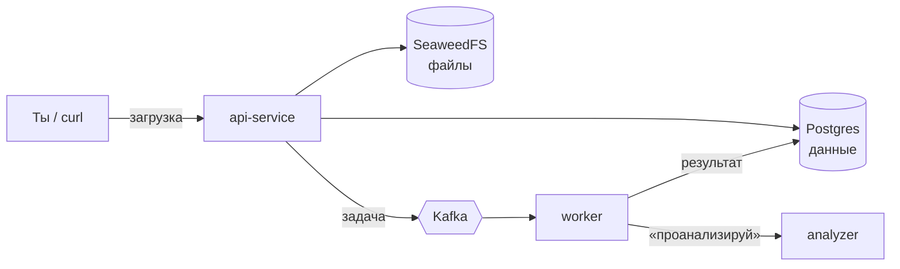

# Photo Analysis

Учебный аналог фото-раздела Облака Mail. Загружаешь фотографию, а сервис в фоне её проверяет:

- не смазана ли она;
- сколько на ней лиц и не закрыты ли у кого-нибудь глаза;
- не слишком ли тёмная или пересвеченная;
- нет ли у тебя уже такой же (дубликаты).

Результаты потом можно получить через API.

## Как это устроено



Если коротко, путь фотографии такой.

1. **api-service** принимает фото, кладёт файл в хранилище **SeaweedFS**, а запись о нём — в **Postgres** со статусом «ждёт обработки». Сразу отвечает тебе, не дожидаясь анализа.
2. Он же ставит задачу в **Kafka**: «проверь фото с таким-то id». В задаче только id и путь к файлу, сама картинка через очередь не ходит.
3. **worker** забирает задачи из Kafka (несколько штук параллельно) и просит **analyzer** проверить каждое фото.
4. **analyzer** скачивает файл из хранилища, считает признаки и возвращает их. Это отдельный сервис на Python с OpenCV.
5. worker ищет похожие фото этого пользователя, сохраняет всё в Postgres и ставит статус «готово».

Зачем так сложно, а не всё в одном сервисе: загрузка остаётся быстрой, даже если анализ медленный. Если анализ упал, задача не теряется. А если фото много, можно просто запустить больше worker'ов.

### Чтобы ничего не терялось

- **Задача не потеряется между базой и Kafka.** Запись о фото и задача сохраняются в базе одной транзакцией (паттерн outbox), а в Kafka задачу переносит отдельный фоновый процесс. Если Kafka на минуту ляжет, задачи дождутся её в базе.
- **Повторная задача ничего не сломает.** Kafka иногда доставляет сообщение дважды. Результат записывается так, что второй раз просто перезапишет то же самое.
- **Сломанные задачи не крутятся вечно.** Три попытки с паузой, потом фото получает статус «ошибка», а задача уходит в отдельную очередь `photos.failed`, где её можно разобрать вручную.

## Что из чего сделано

| Часть | На чём | Зачем |
|---|---|---|
| api-service | Go | REST API для загрузки и получения результатов |
| worker | Go | Разбирает очередь, параллельно на горутинах |
| analyzer | Python, OpenCV | Сам анализ картинок |
| Postgres | — | Фото, статусы, результаты |
| SeaweedFS | — | Файлы. Работает по протоколу S3, как Amazon S3, только у себя. Взят вместо MinIO, потому что образы MinIO из России не скачиваются |
| Kafka | — | Очередь задач |
| Prometheus + Grafana | — | Графики: сколько загружено, обработано, сколько ошибок |

## Как запустить

**Коротко, в каком порядке всё включать** (например, после перезагрузки ноутбука):

1. Открыть Docker Desktop и дождаться «Engine running».
2. `docker compose up -d` в папке проекта: база, хранилище и Kafka.
3. Analyzer: `cd analyzer`, `.venv\Scripts\Activate.ps1`, `python -m photoanalyzer.server`, дождаться `models loaded`.
4. `go run ./cmd/api` — в отдельном окне.
5. `go run ./cmd/worker` — в отдельном окне.

Если api пишет `connection refused` на порт 5433, значит, не запущены контейнеры (шаги 1–2). Порядок 3–5 не строгий: worker дождётся analyzer'а сам.

Подробнее о каждом шаге ниже.

Нужен запущенный Docker Desktop.

```powershell
docker compose up -d
docker compose ps
```

Первый запуск скачивает образы, это несколько минут. Когда всё поднимется, у `postgres`, `seaweedfs` и `kafka` будет статус `healthy`, а `seaweedfs-init` и `kafka-init` отработают и завершатся (`exited (0)`, так и должно быть).

Что можно открыть:

- **Файлы** — http://localhost:8888/buckets/ — там должна быть папка `photos` (это и есть бакет). Ключи доступа к S3 лежат в `deploy/seaweedfs/s3.json`.
- **Kafka UI** (по желанию) — запусти `docker compose --profile ui up -d` и открой http://localhost:8090.

Остановить: `docker compose down`. Остановить и **стереть все данные**: `docker compose down -v`.

Логины и пароли по умолчанию указаны в `docker-compose.yml`. Чтобы поменять, скопируй `.env.example` в `.env` и поправь.

### Запустить api-service

Пока он запускается прямо на ноутбуке, в Docker его упакуем позже.

```powershell
go mod tidy          # один раз: скачает библиотеки
go run ./cmd/api
```

При старте сервис сам создаёт таблицы в базе и бакет в хранилище. Слушает порт 8080.

### Попробовать

В PowerShell пиши именно `curl.exe`: просто `curl` там означает другую команду.

```powershell
# загрузить фото
curl.exe -F "file=@C:\Users\acer\Pictures\cat.jpg" -H "X-User-ID: masha" http://localhost:8080/api/v1/photos

# список своих фото
curl.exe -H "X-User-ID: masha" http://localhost:8080/api/v1/photos

# одно фото (id возьми из ответа на загрузку)
curl.exe -H "X-User-ID: masha" http://localhost:8080/api/v1/photos/ID

# скачать файл обратно
curl.exe -H "X-User-ID: masha" -o back.jpg http://localhost:8080/api/v1/photos/ID/file

# удалить
curl.exe -X DELETE -H "X-User-ID: masha" http://localhost:8080/api/v1/photos/ID

# всё ли подключено
curl.exe http://localhost:8080/readyz
```

`X-User-ID` — это вместо логина: просто имя пользователя в заголовке. Чужие фото по id не видны.

### Посмотреть, что задача ушла в Kafka

После загрузки фото api-service в течение полсекунды отправляет задачу в Kafka. В его логе появится строка `outbox events sent`. Посмотреть сами сообщения:

```powershell
docker compose exec kafka /opt/kafka/bin/kafka-console-consumer.sh --bootstrap-server localhost:9092 --topic photos.uploaded --from-beginning --property print.key=true
```

Выход — Ctrl+C. Если Kafka выключить (`docker compose stop kafka`), загрузка фото всё равно работает: задачи копятся в таблице `outbox` и уходят, когда Kafka вернётся.

### Запустить worker

Worker забирает задачи из Kafka, отправляет фото в analyzer и сохраняет результат. Перед первым запуском сгенерируй Go-код для общения с analyzer: `go generate ./gen`. Нужны `protoc`, `protoc-gen-go` и `protoc-gen-go-grpc`. Сгенерированные файлы появятся в `gen/analyzer/v1`, их надо закоммитить.

```powershell
go generate ./gen
go mod tidy
go run ./cmd/worker
```

Worker должен работать одновременно с api-service и analyzer, у каждого своё окно. Порядок запуска не важен: если analyzer ещё не поднялся, worker повторит попытку.

Сколько фото обрабатывать параллельно, задаёт `WORKER_CONCURRENCY` (по умолчанию 4). Фото одного пользователя всё равно обрабатываются строго по очереди: иначе два его снимка могли бы одновременно искать дубликаты друг у друга и не найти.

Что бывает, если что-то пошло не так:

- **Analyzer выключен или перезапускается.** Worker ждёт его и фото не бросает: пауза растёт 2 → 4 → 8 → 16 → 30 секунд и дальше держится на 30, пока analyzer не вернётся. В логе при этом строки `analyzer unavailable, waiting`.
- **Analyzer упал на конкретном фото** (ошибка внутри, таймаут). Ещё две попытки через 2 и 4 секунды, потом статус `failed`.
- **Файл битый или пропал из хранилища.** Повторять бесполезно, фото сразу получает `failed`.

Упавшие задачи попадают в очередь `photos.failed` вместе с причиной:

```powershell
docker compose exec kafka /opt/kafka/bin/kafka-console-consumer.sh --bootstrap-server localhost:9092 --topic photos.failed --from-beginning
```

### Проанализировать заново

Если фото упало или поменялись пороги, его можно отправить на анализ ещё раз:

```powershell
curl.exe -X POST -H "X-User-ID: masha" http://localhost:8080/api/v1/photos/ID/reanalyze
curl.exe -X POST -H "X-User-ID: masha" http://localhost:8080/api/v1/photos/reanalyze-failed
```

Первая команда для одного фото, вторая для всех упавших сразу (в ответе их число). Фото, которое уже стоит в очереди, второй раз не ставится, в ответ придёт `409`.

### Посмотреть результат анализа

```powershell
curl.exe -H "X-User-ID: masha" http://localhost:8080/api/v1/photos/ID/analysis
```

Пока фото в очереди, ответ будет `202` со статусом. Когда анализ готов, придёт `200` с результатом: смазанность, лица, закрытые глаза, яркость, список дубликатов и причины, почему кадр неудачный.

Список можно фильтровать:

```powershell
curl.exe -H "X-User-ID: masha" "http://localhost:8080/api/v1/photos?bad_shot=true"
curl.exe -H "X-User-ID: masha" "http://localhost:8080/api/v1/photos?duplicates=true"
curl.exe -H "X-User-ID: masha" "http://localhost:8080/api/v1/photos?blurry=true"
```

### Запустить analyzer (анализ фото, Python)

Нужен Python 3.12 (3.13 тоже подойдёт). Всё делается в папке `analyzer`:

```powershell
cd analyzer
python -m venv .venv
.venv\Scripts\Activate.ps1
pip install -r requirements.txt
python download_models.py   # один раз: две готовые модели, ~4 МБ
python gen_proto.py         # код для gRPC из analyzer.proto
python -m pytest            # тесты
python -m photoanalyzer.server
```

Если PowerShell не даёт запустить `Activate.ps1`, один раз выполни `Set-ExecutionPolicy -Scope CurrentUser RemoteSigned`.

Проверить на уже загруженном фото (в другом окне, тоже с активированным `.venv`):

```powershell
python try_client.py masha/ID_ФОТО
```

### Подобрать пороги на своих фото

```powershell
python calibrate.py "C:\Users\acer\Pictures\test"
```

Скрипт напечатает для каждого фото резкость, яркость, число лиц и оценки «насколько закрыты глаза» (0 — открыты, 1 — закрыты), а ещё пары похожих фото. Таблица сохранится в `calibration.csv`. Пороги меняются переменными окружения, например `$env:BLUR_THRESHOLD=80`.

## Где что лежит

| Путь | Что там |
|---|---|
| `api/openapi.yaml` | Описание REST API: какие запросы, что отвечают |
| `proto/analyzer/v1/analyzer.proto` | Как worker разговаривает с analyzer (gRPC) |
| `analyzer/` | Сервис анализа на Python |
| `cmd/api/`, `cmd/worker/` | Запуск api-service и worker |
| `gen/` | Go-код, сгенерированный из `analyzer.proto` |
| `internal/` | Код сервисов: API, база, хранилище, Kafka, outbox |
| `migrations/` | Таблицы в базе (накатываются при старте api-service) |
| `docker-compose.yml` | Запуск всего локально |

## Как проверяются фото

Все проверки делаются на уменьшенной копии фото, поэтому пороги не зависят от того, на какую камеру оно снято.

| Что | Как | Когда «плохо» (пока) |
|---|---|---|
| Смазанность | насколько резкие перепады яркости (дисперсия лапласиана). Фото делится на 16 клеток, берётся самая резкая: так портрет с размытым фоном не считается смазанным | меньше 50 |
| Лица | детектор YuNet из OpenCV, порог уверенности 0,6 (с 0,8 пропускал крупные, наклонённые и смазанные лица) | — |
| Закрытые глаза | для каждого лица MediaPipe оценивает, насколько закрыт каждый глаз (0–1). Берём меньший из двух, чтобы подмигивание не считалось | 0,5 и больше |
| Яркость | средняя яркость от 0 до 255 | меньше 40 или больше 215 |
| Дубликаты | «отпечаток» картинки (перцептивный хеш, 64 бита). У копии, уменьшенной или пересжатой версии отпечаток почти такой же | отличаются не больше чем в 6 битах |

Фото считается **неудачным кадром**, если оно смазано, слишком тёмное или светлое, или у кого-то закрыты глаза.

Глаза проверяются только у лиц покрупнее (от 60 пикселей): на мелких лицах в групповом фото оценка ненадёжна.

## Готовность

- [x] Архитектура и контракты
- [x] Инфраструктура в docker-compose
- [x] api-service: загрузка, просмотр, скачивание, удаление
- [x] Отправка задач в Kafka (через outbox)
- [x] analyzer (пороги ещё подбираются)
- [x] worker: очередь, повторы, дубликаты, результаты в API
- [ ] Метрики и Grafana
- [ ] Kubernetes
