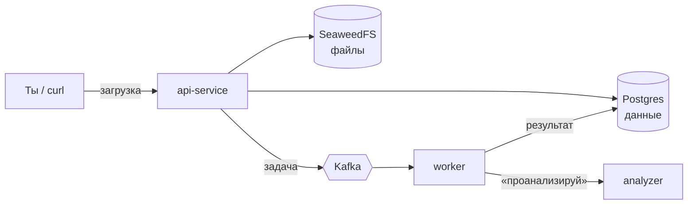

# Photo Analysis

Учебный аналог фото-раздела Облака Mail. Загружаешь фотографию, а сервис в фоне её проверяет:

- не смазана ли она;
- сколько на ней лиц и не закрыты ли у кого-нибудь глаза;
- не слишком ли тёмная или пересвеченная;
- нет ли у тебя уже такой же (дубликаты).

Результаты потом можно получить через API.

## Как это устроено



Если коротко, путь фотографии такой.

1. **api-service** принимает фото, кладёт файл в хранилище **SeaweedFS**, а запись о нём — в **Postgres** со статусом «ждёт обработки». Сразу отвечает тебе, не дожидаясь анализа.
2. Он же ставит задачу в **Kafka**: «проверь фото с таким-то id». В задаче только id и путь к файлу, сама картинка через очередь не ходит.
3. **worker** забирает задачи из Kafka (несколько штук параллельно) и просит **analyzer** проверить каждое фото.
4. **analyzer** скачивает файл из хранилища, считает признаки и возвращает их. Это отдельный сервис на Python с OpenCV.
5. worker ищет похожие фото этого пользователя, сохраняет всё в Postgres и ставит статус «готово».

Зачем так сложно, а не всё в одном сервисе: загрузка остаётся быстрой, даже если анализ медленный. Если анализ упал, задача не теряется. А если фото много, можно просто запустить больше worker'ов.

### Чтобы ничего не терялось

- **Задача не потеряется между базой и Kafka.** Запись о фото и задача сохраняются в базе одной транзакцией (паттерн outbox), а в Kafka задачу переносит отдельный фоновый процесс. Если Kafka на минуту ляжет, задачи дождутся её в базе.
- **Повторная задача ничего не сломает.** Kafka иногда доставляет сообщение дважды. Результат записывается так, что второй раз просто перезапишет то же самое.
- **Сломанные задачи не крутятся вечно.** Три попытки с паузой, потом фото получает статус «ошибка», а задача уходит в отдельную очередь `photos.failed`, где её можно разобрать вручную.

## Что из чего сделано

| Часть | На чём | Зачем |
|---|---|---|
| api-service | Go | REST API для загрузки и получения результатов |
| worker | Go | Разбирает очередь, параллельно на горутинах |
| analyzer | Python, OpenCV | Сам анализ картинок |
| Postgres | — | Фото, статусы, результаты |
| SeaweedFS | — | Файлы. Работает по протоколу S3, как Amazon S3, только у себя. Взят вместо MinIO, потому что образы MinIO из России не скачиваются |
| Kafka | — | Очередь задач |
| Prometheus + Grafana | — | Графики: сколько загружено, обработано, сколько ошибок |

## Как запустить

Нужен запущенный Docker Desktop.

```powershell
docker compose up -d
docker compose ps
```

Первый запуск скачивает образы, это несколько минут. Когда всё поднимется, у `postgres`, `seaweedfs` и `kafka` будет статус `healthy`, а `seaweedfs-init` и `kafka-init` отработают и завершатся (`exited (0)`, так и должно быть).

Что можно открыть:

- **Файлы** — http://localhost:8888/buckets/ — там должна быть папка `photos` (это и есть бакет). Ключи доступа к S3 лежат в `deploy/seaweedfs/s3.json`.
- **Kafka UI** (по желанию) — запусти `docker compose --profile ui up -d` и открой http://localhost:8090.

Остановить: `docker compose down`. Остановить и **стереть все данные**: `docker compose down -v`.

Логины и пароли по умолчанию указаны в `docker-compose.yml`. Чтобы поменять, скопируй `.env.example` в `.env` и поправь.

## Где что лежит

| Путь | Что там |
|---|---|
| `api/openapi.yaml` | Описание REST API: какие запросы, что отвечают |
| `proto/analyzer/v1/analyzer.proto` | Как worker разговаривает с analyzer (gRPC) |
| `migrations/` | Таблицы в базе |
| `docker-compose.yml` | Запуск всего локально |

## Как проверяются фото (первая версия, пороги ещё подбираются)

| Что | Как | Когда «плохо» |
|---|---|---|
| Смазанность | насколько резкие границы на картинке (дисперсия лапласиана) | меньше 100 |
| Лица | готовый детектор лиц | — |
| Закрытые глаза | отношение высоты глаза к ширине | меньше 0,2 |
| Яркость | средняя яркость от 0 до 255 | меньше 40 или больше 215 |
| Дубликаты | «отпечаток» картинки (перцептивный хеш), сравниваем отпечатки | отличаются не больше чем в 6 битах из 64 |

Фото считается **неудачным кадром**, если оно смазано, слишком тёмное или светлое, или у кого-то закрыты глаза.

## Готовность

- [x] Архитектура и контракты
- [x] Инфраструктура в docker-compose
- [ ] api-service
- [ ] analyzer
- [ ] worker
- [ ] Метрики и Grafana
- [ ] Kubernetes
