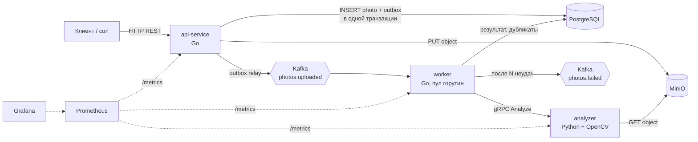

# Photo Analysis — сервис анализа фотографий для облачного хранилища

Упрощённый аналог фото-раздела Облака Mail. Сервис принимает фотографии, сохраняет их и асинхронно анализирует через Kafka. Результаты отдаются по REST API: смазанность, количество лиц, дубликаты, неудачные кадры.

> Статус: шаг 1 — проектирование. Код сервисов появится на следующих шагах.

## Архитектура



| Компонент | Язык | Что делает |
|---|---|---|
| `api-service` | Go | REST API: загрузка, статус, результаты, фильтры. Сохраняет файл в MinIO, метаданные — в Postgres, событие — в outbox. Отдельная горутина переносит outbox в Kafka. |
| `worker` | Go | Consumer group Kafka, пул из N горутин. Вызывает analyzer по gRPC, ищет дубликаты, пишет результат. Повторы с паузой, затем DLQ. |
| `analyzer` | Python | «Внешняя зависимость» по заданию: OpenCV / mediapipe / imagehash. gRPC-сервер, контракт в `proto/`. |
| PostgreSQL | — | Фото, статусы, результаты, дубликаты, outbox. |
| MinIO | — | Сами файлы (S3-совместимое хранилище). |
| Kafka | — | Очередь задач (`photos.uploaded`) и очередь упавших задач (`photos.failed`). |
| Prometheus + Grafana | — | Метрики и дашборд. |

## Жизненный цикл фото

1. `POST /api/v1/photos`. API проверяет тип и размер, кладёт файл в MinIO под ключом `{user_id}/{photo_id}`, затем в одной транзакции пишет строку в `photos` (status `pending`) и событие в `outbox`. Ответ `202` с `id`.
2. Outbox relay отправляет событие в `photos.uploaded` (ключ сообщения — `user_id`, чтобы фото одного пользователя попадали в одну партицию и поиск дубликатов шёл последовательно) и отмечает `sent_at`.
3. Worker получает сообщение и ставит status `processing`, `attempts + 1`. Затем вызывает `Analyzer.Analyze` с таймаутом.
4. Worker сравнивает `phash` с остальными фото пользователя. Если расстояние Хэмминга ≤ 6, это дубликат, пара записывается в `duplicates`.
5. В одной транзакции: `INSERT ... ON CONFLICT DO UPDATE` в `analysis`, status `done`. Только после этого коммитится offset в Kafka.
6. При ошибке: до 3 повторов с экспоненциальной паузой. Потом status `failed`, сообщение уходит в `photos.failed`.

**Повторная доставка безопасна:** запись результата идемпотентна (upsert по `photo_id`), так что дубль сообщения просто перезапишет тот же результат.

## Контракты

- REST API: [`api/openapi.yaml`](api/openapi.yaml)
- gRPC analyzer: [`proto/analyzer/v1/analyzer.proto`](proto/analyzer/v1/analyzer.proto)
- Схема БД: [`migrations/0001_init.up.sql`](migrations/0001_init.up.sql)
- Событие Kafka `photos.uploaded` (JSON):

```json
{
  "event_id": "b6f1…",
  "photo_id": "0f8c…",
  "user_id": "user-1",
  "bucket": "photos",
  "object_key": "user-1/0f8c…",
  "uploaded_at": "2026-11-10T12:00:00Z"
}
```

## Правила анализа (начальные пороги, уточняются на шаге 5)

| Признак | Как считается | Порог |
|---|---|---|
| Смазанность | дисперсия лапласиана по серому изображению, сжатому до 1024 px по длинной стороне | `< 100` → смазано |
| Лица | детектор лиц OpenCV DNN (или mediapipe) | — |
| Закрытые глаза | mediapipe Face Mesh, отношение высоты глаза к ширине (EAR) | `EAR < 0,2` → закрыт |
| Экспозиция | средняя яркость 0–255 | `< 40` недосвет, `> 215` пересвет |
| Дубликаты | pHash 64 бита, расстояние Хэмминга | `≤ 6` → дубликат |
| Неудачный кадр | смазано ИЛИ закрыты глаза ИЛИ недосвет/пересвет | — |

## Метрики (план)

- `http_requests_total{route,code}`, `http_request_duration_seconds{route}`
- `photos_uploaded_total`, `photo_upload_bytes`
- `outbox_pending` — сколько событий ещё не отправлено
- `worker_jobs_total{result="done|retry|failed"}`, `worker_job_duration_seconds`
- `analyzer_call_duration_seconds`, `kafka_consumer_lag`

## Структура репозитория

```
api/openapi.yaml            REST-контракт
proto/analyzer/v1/          gRPC-контракт
migrations/                 SQL-миграции
cmd/api, cmd/worker         (шаги 3–6) точки входа Go-сервисов
internal/                   (шаги 3–6) общий Go-код
analyzer/                   (шаг 5) Python-сервис
deploy/                     docker-compose, k8s-манифесты, дашборд Grafana
```

## Запуск

Появится на шаге 2 (docker-compose) и шаге 9 (Kubernetes).
